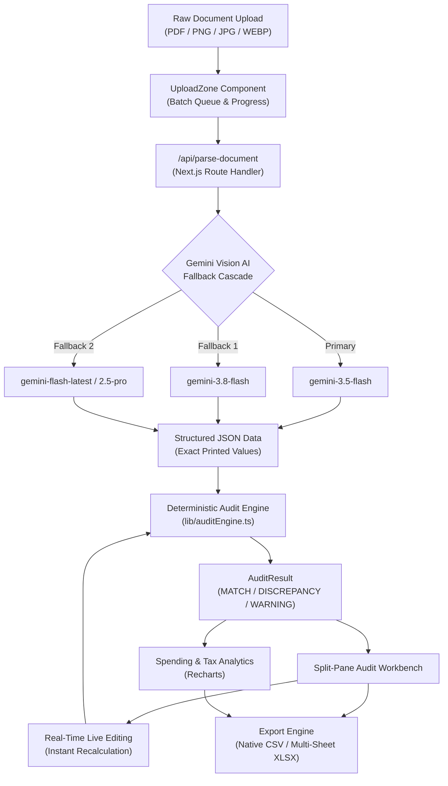

# 📑 Multimodal Smart Document & Invoice Intelligence Hub

<div align="center">

[](https://hackathon-pink-omega.vercel.app/)
[](https://github.com/shivankshetty8/Hackathon)
[](https://nextjs.org/)
[](https://www.typescriptlang.org/)
[](https://aistudio.google.com/)
[](https://tailwindcss.com/)

<p align="center">
  <b>An enterprise-grade forensic financial document auditor powered by Google Gemini Vision AI and deterministic mathematics.</b><br/>
  Ingests raw invoices, receipts, and utility bills (PDFs and images), extracts structured data with zero hallucination, audits calculations for vendor overcharges and tax discrepancies, provides an interactive split-pane reconciliation workbench, and exports clean data to CSV and multi-sheet Excel workbooks.
</p>

[**Explore Live App »**](https://hackathon-pink-omega.vercel.app/) · [**View Source Code »**](https://github.com/shivankshetty8/Hackathon) · [**Report Issue »**](https://github.com/shivankshetty8/Hackathon/issues)

</div>

---

## 🌐 Live Application Links

| Destination | Link | Status |
| :--- | :--- | :---: |
| **Production Deployment (Vercel)** | [https://hackathon-pink-omega.vercel.app](https://hackathon-pink-omega.vercel.app/) |  |
| **GitHub Repository** | [https://github.com/shivankshetty8/Hackathon](https://github.com/shivankshetty8/Hackathon) |  |

---

## 💡 The Core Problem & Forensic Philosophy

In commercial enterprise operations, accounts payable teams process thousands of invoices each month. Manual auditing is slow and error-prone, while traditional OCR systems struggle with varying invoice formats.

Crucially, **naive generative AI wrappers fail at financial auditing** because Large Language Models are probabilistic and prone to mathematical hallucinations—frequently "fixing" or making up calculations instead of catching billing mistakes.

### 🛡️ The Hybrid Architecture Solution
**Invoice Intelligence Hub** separates **perception** from **computation**:
1. **Perception (Gemini Vision AI):** Extracts printed numbers with literal fidelity. It is strictly instructed *never* to recalculate or fix math errors on the document.
2. **Computation (Deterministic TypeScript Engine):** Every calculation ($\text{Quantity} \times \text{Unit Price}$, Subtotal sum, Tax rates, Discounts, Shipping, and Grand Totals) is audited line-by-line using deterministic, IEEE-754 rounded arithmetic.

```
┌───────────────────────────────┐     ┌──────────────────────────────┐
│  Raw Document (PDF / Images)  │ ──► │  Gemini Vision API Route     │
└───────────────────────────────┘     │  (Literal Text & Numbers)    │
                                      └──────────────┬───────────────┘
                                                     ▼
┌───────────────────────────────┐     ┌──────────────────────────────┐
│  Split-Pane Workbench & Export│ ◄── │  Deterministic Audit Engine  │
│  (XLSX / CSV / Interactive UI)│     │  (Pure JS Math Recalculation)│
└───────────────────────────────┘     └──────────────────────────────┘
```

---

## ⚡ Key Modules & Capabilities

### 1. Multimodal Document Ingestion & Multi-Model Fallback Cascade
* **Broad Media Support:** Natively processes `application/pdf`, `image/png`, `image/jpeg`, and `image/webp`.
* **Zero-Failure Fallback Cascade:** To prevent quota exhaustion, rate limits (`429`), or transient model deprecation from halting enterprise workflows, the backend automatically cascades through an 8-tier Gemini fallback chain:
  $$\text{gemini-3.5-flash} \longrightarrow \text{gemini-3.8-flash} \longrightarrow \text{gemini-flash-latest} \longrightarrow \text{gemini-2.5-pro} \longrightarrow \text{gemini-3.7-flash} \longrightarrow \dots$$
* **Strict Type Enforcement:** Enforces JSON outputs via `responseSchema` and `responseMimeType: "application/json"`.

### 2. Deterministic Math & Tax Auditing Engine
* **Line-Level Multiplication Check:** Computes $\text{calculatedAmount} = \text{roundToTwo}(\text{qty} \times \text{unitPrice})$. Flags an error if $|\text{extractedAmount} - \text{calculatedAmount}| > \$0.01$.
* **Subtotal Aggregation Check:** Sums all verified line items. Flags discrepancies exceeding $\$0.02$.
* **Tax Sanity Benchmarking:** Calculates $\text{effectiveTaxRate} = (\frac{\text{tax}}{\text{calculatedSubtotal}}) \times 100$. Flags an amber warning if tax is anomalous ($> 30\%$) or missing.
* **Grand Total Balancing:** Validates $\text{calculatedGrandTotal} = \text{subtotal} + \text{tax} + \text{shipping} - \text{discount}$ against printed invoice figures.
* **Badge System:**
  * 🟢 **MATCH:** All line items, taxes, and totals balance to the exact cent.
  * 🔴 **DISCREPANCY:** Highlights exact vendor calculation overcharges or addition errors.
  * 🟠 **WARNING:** Arithmetic checks out, but anomalous tax or missing invoice metadata detected.

### 3. Split-Pane Interactive Reconciliation Workbench
* **Document Viewer (Left Pane):** High-resolution image/PDF viewer with zoom controls (up to 300%), $90^\circ$ clockwise rotation, pan dragging, and key metadata badges (Vendor, Invoice #, Date, Currency).
* **Editable Reconciliation Table (Right Pane):**
  * Editable fields: Description, Expense Category dropdown, Quantity, Unit Price, Printed Total.
  * Read-only Audited Total column showing deterministic calculation.
  * Real-time calculation triggers on every keystroke.
* **"Auto-Fix Printed Totals" Action:** One-click utility that automatically snaps mismatched printed values to their audited sums.
* **Executive Comparison Footer:** Side-by-side reconciliation of printed values vs. audited values with delta indicators ($+\$10.00$, $-\$4.50$).

### 4. Interactive Spending & Tax Analytics
* **Category Breakdown (Donut Chart):** Interactive visualization across 7 expense categories (*Software & SaaS, Utilities, Office Supplies, Travel & Meals, Hardware, Professional Services, Other*).
* **Vendor & Tax Comparison (Stacked Bar Chart):** Compares Subtotal vs. Tax vs. Discrepancy gap per vendor.
* **Executive KPI Cards:**
  * *Total Audited Spend*
  * *Vendor Discrepancies Caught (Dollar amount & Count)*
  * *Average Effective Tax Rate*
  * *Reconciled Document Count with status breakdown*

### 5. Multi-Sheet Excel & CSV Export Engine
* **CSV Export:** Flattens all line items with document metadata for standard accounting import.
* **Formatted Multi-Sheet XLSX (SheetJS):**
  * **Sheet 1 (`Summary & Audit Status`):** High-level overview of invoices, audit status, totals, and discrepancies.
  * **Sheet 2 (`Line Items Detail`):** Itemized breakdown with descriptions, categories, quantities, prices, and error flags.
  * **Sheet 3 (`Tax & Discrepancy Log`):** Detailed log of all flagged mathematical discrepancies and tax anomalies.

### 6. Design System & Typography
* **Color Palette:** Pure dark obsidian (`#09090b`), elevated card containers (`#121215`), border dividers (`#27272a`), and warm energetic orange accents (`#f97316`). Zero distracting purple gradients.
* **Typography:** **Poppins** for clean modern headings and body prose, paired with **JetBrains Mono** for numeric tabular amounts, currency symbols, and mathematical deltas.

---

## 🏗️ System Architecture & Data Flow



---

## 🧪 Demonstration Test Scenarios

The repository includes realistic test scenarios to verify forensic auditing capabilities:

| Test Invoice | Category | Injected Scenario | Auditor Response |
| :--- | :--- | :--- | :---: |
| **CloudScale AWS Hosting** | Infrastructure | 100% clean arithmetic and 8.25% standard tax. | 🟢 **MATCH** |
| **Apex Office Supplies** | Procurement | Line 2 item ($4 \times \$12.50$) printed as $\$60.00$ instead of $\$50.00$. Grand total overcharged by $\$10.00$. | 🔴 **DISCREPANCY** (Flags $\$10.00$ overcharge) |
| **Metro City Power & Electric** | Utility | Valid line item math, but effective tax rate calculated at **34.03%**. | 🟠 **WARNING** (Flags anomalous tax rate) |

---

## 🛠️ Tech Stack & Dependencies

| Layer | Technology | Purpose |
| :--- | :--- | :--- |
| **Core Framework** | [Next.js 16](https://nextjs.org/) (App Router) | High-performance full-stack React framework |
| **Language** | [TypeScript 5](https://www.typescriptlang.org/) | Strict type safety across document schemas and audit states |
| **AI / Multimodal** | [`@google/genai`](https://www.npmjs.com/package/@google/genai) | Official Google Gen AI SDK for Gemini Vision models |
| **Styling & UI** | [Tailwind CSS 3.4](https://tailwindcss.com/) | Bespoke dark-mode styling with Poppins and JetBrains Mono fonts |
| **Icons** | [`lucide-react`](https://lucide.dev/) | Clean, accessible iconography |
| **Data Visualization** | [`recharts`](https://recharts.org/) | Responsive SVG Donut Charts and Stacked Bar Charts |
| **Spreadsheet Engine** | [`xlsx` (SheetJS)](https://sheetjs.com/) | Client-side generation of styled multi-sheet Excel workbooks |
| **Hosting & CI/CD** | [Vercel](https://vercel.com/) | Global Edge deployment with automatic Git CI/CD |

---

## 📐 Data Contracts (`src/types/invoice.ts`)

```typescript
export type ExpenseCategory =
  | 'Software & SaaS'
  | 'Utilities'
  | 'Office Supplies'
  | 'Travel & Meals'
  | 'Hardware & Equipment'
  | 'Professional Services'
  | 'Other';

export interface LineItem {
  id: string;
  description: string;
  category: ExpenseCategory;
  quantity: number;
  unitPrice: number;
  extractedAmount: number;   // Literal printed total
  calculatedAmount: number;  // Deterministic (quantity * unitPrice)
  hasLineDiscrepancy: boolean;
}

export interface AuditResult {
  calculatedSubtotal: number;
  subtotalDiscrepancy: number;
  calculatedGrandTotal: number;
  grandTotalDiscrepancy: number;
  effectiveTaxRate: number;
  status: 'MATCH' | 'DISCREPANCY' | 'WARNING';
  flags: string[];           // Forensic findings
}
```

---

## 💻 Local Setup & Development

Follow these steps to run the project locally on your machine:

### 1. Clone the repository
```bash
git clone https://github.com/shivankshetty8/Hackathon.git
cd Hackathon
```

### 2. Install dependencies
```bash
npm install
```

### 3. Configure environment variables
Create a `.env.local` file in the project root:
```env
# Get your free key at https://aistudio.google.com/apikey
GEMINI_API_KEY=your_gemini_api_key_here
```

### 4. Run the development server
```bash
npm run dev
```

Open [http://localhost:3000](http://localhost:3000) in your browser.

### 5. Build for production
```bash
npm run build
npm run start
```

---

## 🏆 Hackathon Submission Highlights

* ✅ **End-to-End Functional:** Zero mock placeholders, zero dummy stubs, and fully functioning multimodal pipeline.
* ✅ **Dual AI-Deterministic Architecture:** Prevents hallucinated financial figures by coupling Gemini Vision with deterministic calculations.
* ✅ **Multi-Model Reliability:** Built-in auto-fallback cascade guarantees high availability even under rate limits.
* ✅ **Interactive Reconciliation:** Allows financial controllers to audit, edit, and auto-fix discrepancies with live updates.
* ✅ **Production Deployed:** Deployed and verified on Vercel at [hackathon-pink-omega.vercel.app](https://hackathon-pink-omega.vercel.app/).

---

## 👤 Author

* **Shivank Shetty** — [GitHub Profile](https://github.com/shivankshetty8)

---

## 📄 License

This project is licensed under the MIT License — see the [LICENSE](LICENSE) file for details.
